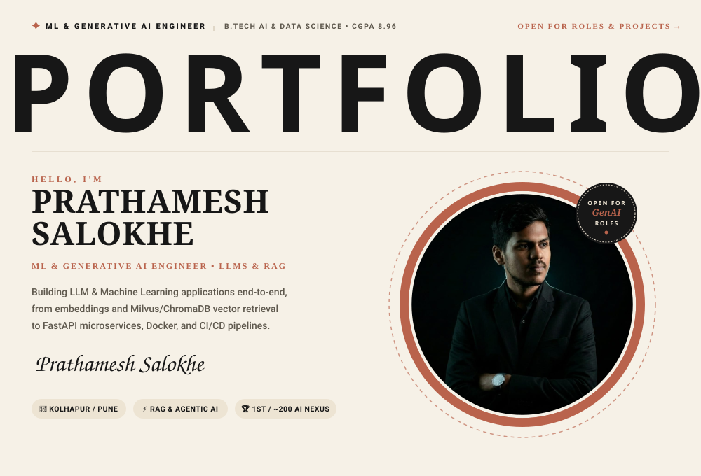
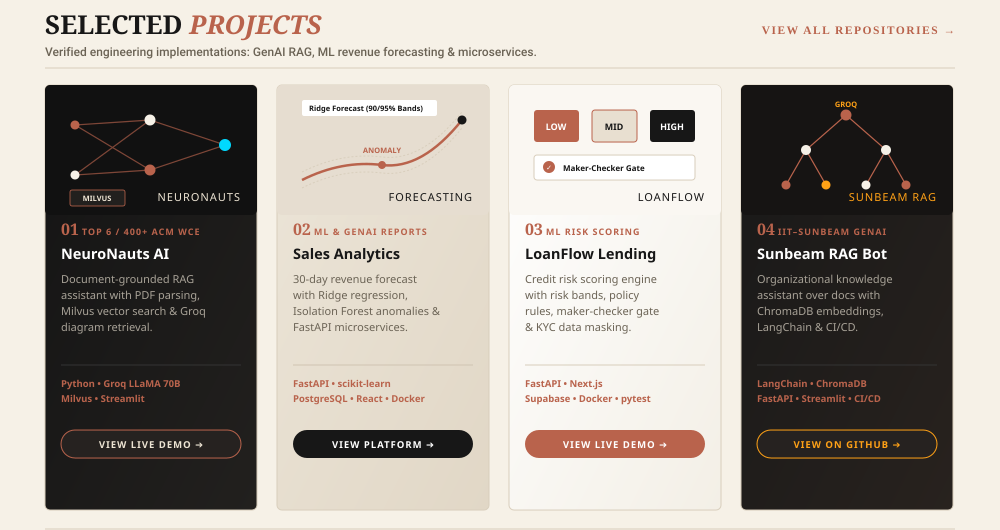
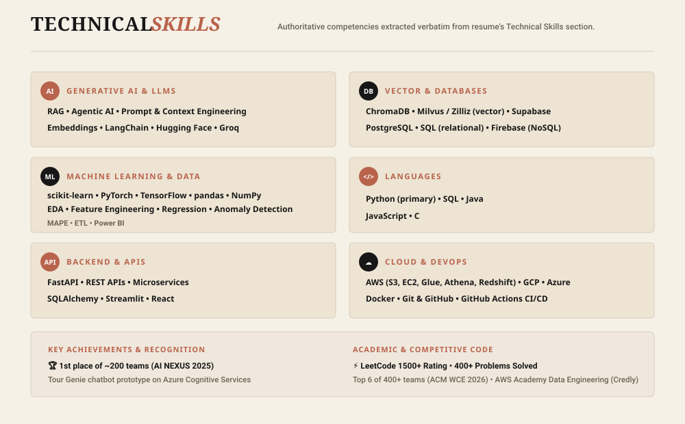
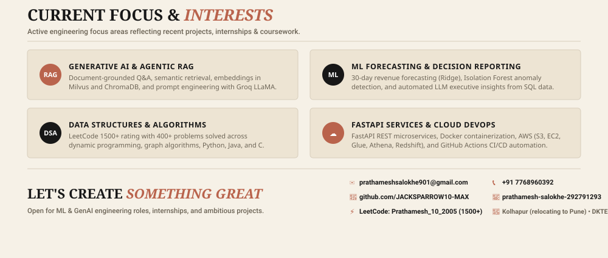
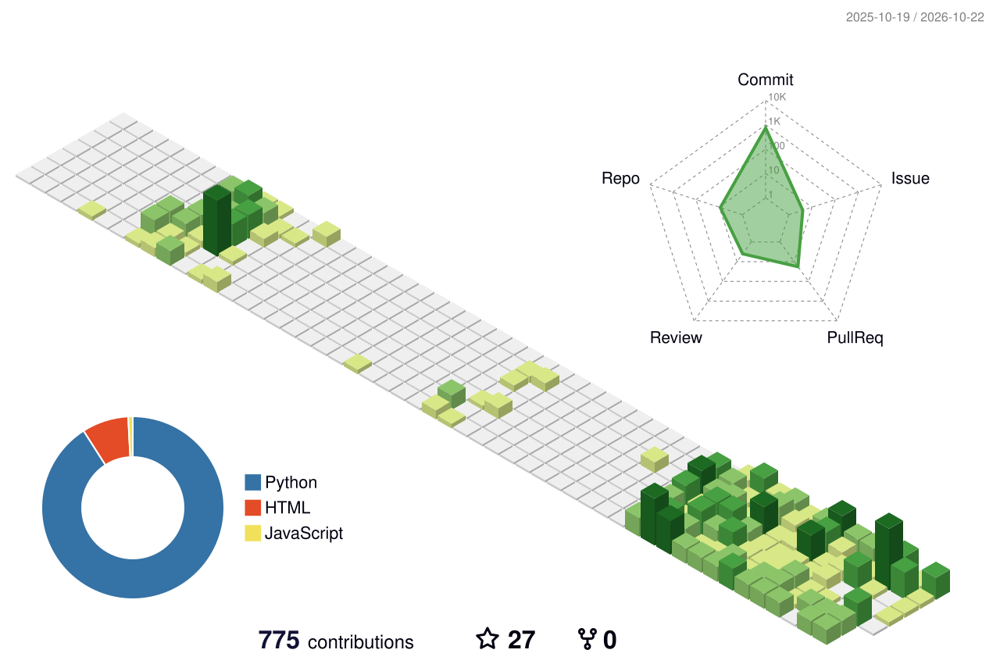

<!-- Hero Banner (Identity, Editorial Headline, Portrait) -->

<!-- Selected Projects Grid (NeuroNauts, Sales Analytics, LoanFlow, Sunbeam RAG) -->

<!-- Technical Skills Section (Authoritative verbatim from Resume) -->

<!-- Current Focus & Connect Section -->

 

<!-- Verified Contact & Professional Links -->

  
  &nbsp;
  
  &nbsp;
  
  &nbsp;
  

 

<!-- 3D Contribution Graph -->

  
<b>📊 View 3D GitHub Contribution Activity</b>

   
  

 

  ✦ B.Tech in AI & Data Science (CGPA 8.96/10) • DKTE Ichalkaranji • Kolhapur (Relocating to Pune) ✦

